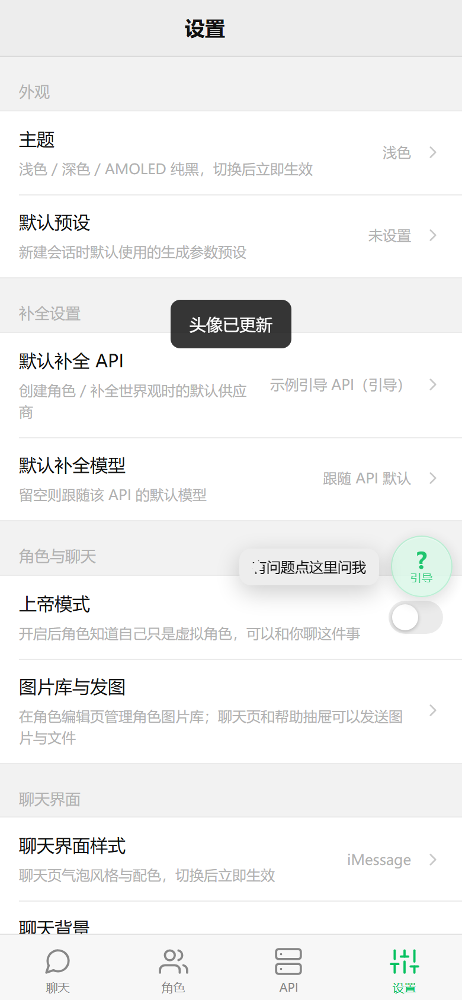
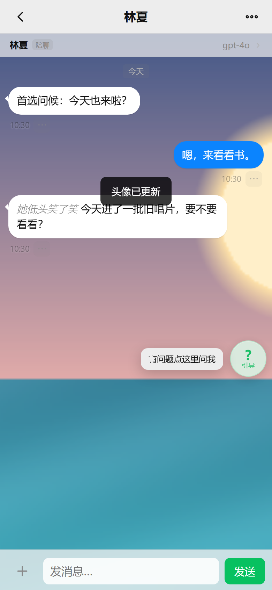
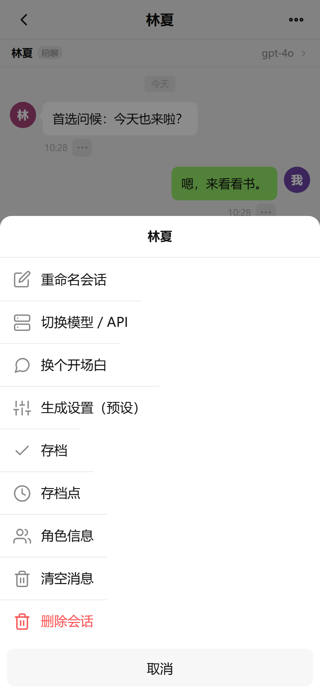
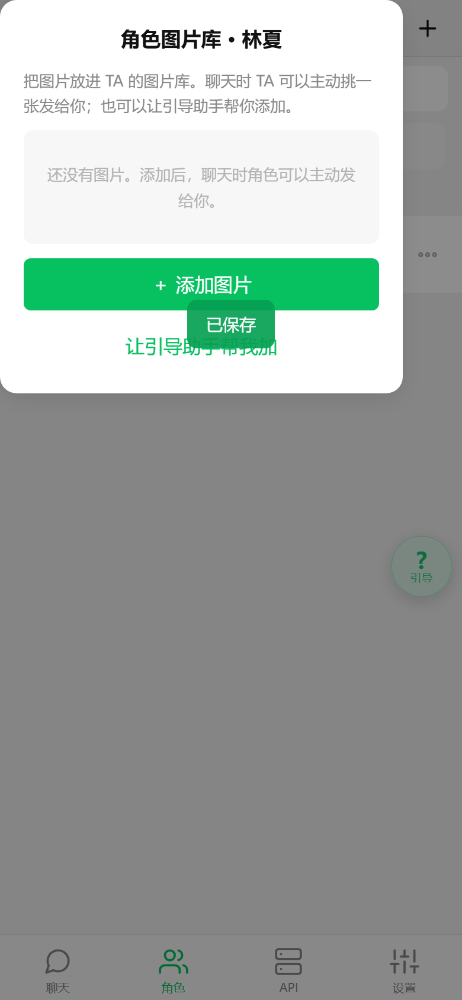
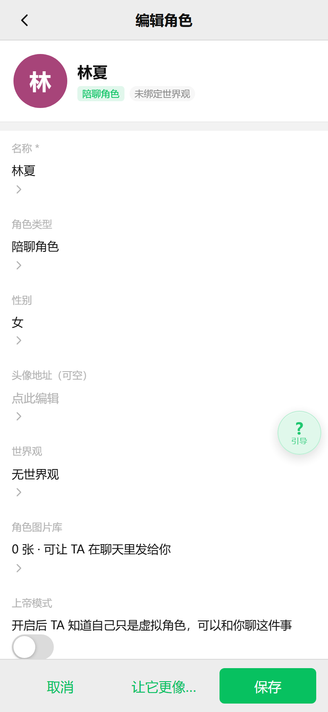
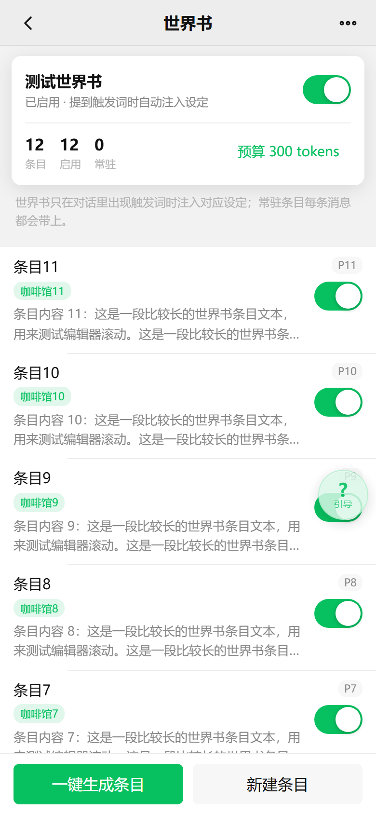
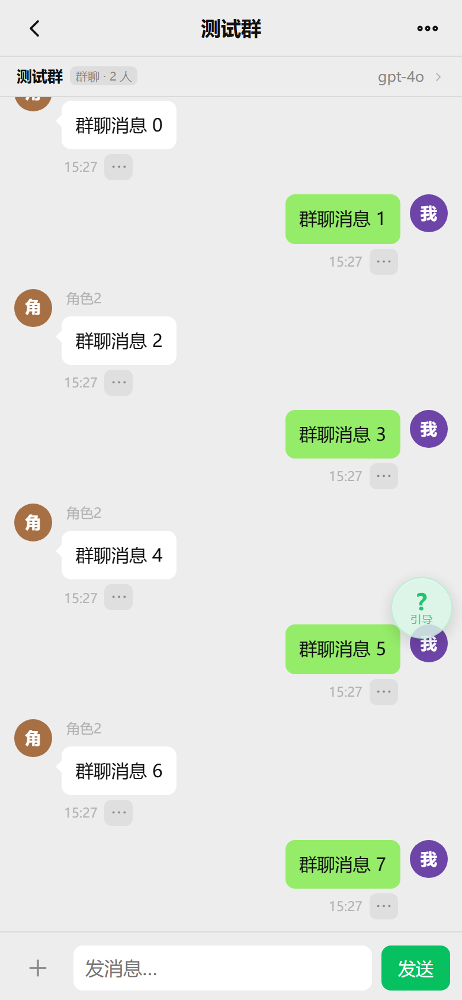
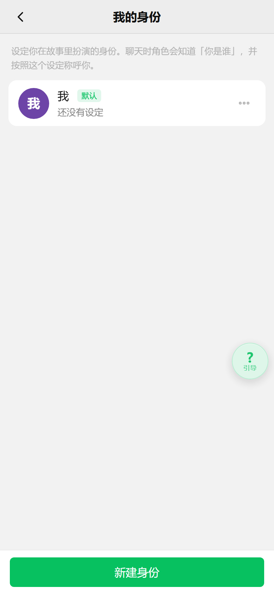
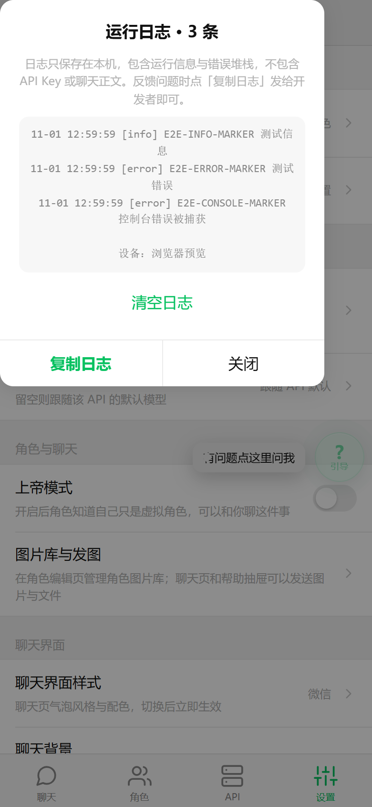

# AI 聊天 · Android App

按 [`prompt-01-需求提示词.md`](prompt-01-需求提示词.md) 实现的微信式 AI 聊天应用：远程 OpenAI 兼容 API、角色/世界观体系、角色主动消息与问候语、聊天外观与会话存档、人格导入、世界书、群聊、角色卡（TavernAI V2）导入导出、多身份、消息分支、强制首次引导、应用内悬浮引导气泡。

**零第三方依赖**（原生 Java 壳 + 纯 HTML/CSS/vanilla JS），手工构建管线（aapt2 → javac → d8 → zipalign → apksigner），不依赖 Gradle。包名 `com.aichat.client`，Android 8.0+（minSdk 26，targetSdk 34）。

## 版本与下载

APK 均发布在 [Releases](https://github.com/CamFridge/ai-chat-app/releases) 页面，同签名（`CN=AI Chat`），可直接覆盖升级。

| 版本 | versionCode | 更新主题 | 大小 | SHA-256 |
| --- | --- | --- | --- | --- |
| [v1.4.3](https://github.com/CamFridge/ai-chat-app/releases/download/v1.4.3/AI-Chat-1.4.3.apk) | 16 | 老内核（Chrome 70 WebView）气泡重叠 / 整页错位修复 | 418,344 B | `00BA86418E130B52F06093F6389EC93619CEA93C32B9F1236B8161A8E1118932` |
| [v1.4.2](https://github.com/CamFridge/ai-chat-app/releases/download/v1.4.2/AI-Chat-1.4.2.apk) | 15 | 聊天页点击换头像/背景、空白气泡与键盘遮挡修复 | 418,344 B | `28A15B9F1DCBAAB72EB11AE2F8C2F804EDF0231FBF2BF645CF67077CC3F73CB6` |
| [v1.4.1](https://github.com/CamFridge/ai-chat-app/releases/download/v1.4.1/AI-Chat-1.4.1.apk) | 14 | 页面错位/不能滑动加固 + 「界面自检」取证入口 | 414,248 B | `0FAB1B5FF9DE96F1D05665FCDF0B154A6453504E752755D238891275C5314DC7` |
| [v1.4.0](https://github.com/CamFridge/ai-chat-app/releases/download/v1.4.0/AI-Chat-1.4.0.apk) | 13 | 世界书、群聊、角色卡 V2、多身份、消息分支、预设文本模式 | 410,152 B | `48E6363C7CCE0FA9295502FAEA69EDF282813FBAB2520C40DEB4D9A34FF3440E` |
| [v1.3.5](https://github.com/CamFridge/ai-chat-app/releases/download/v1.3.5/AI-Chat-1.3.5.apk) | 12 | 按钮自适应、长图显示、粘贴长文生成人格 | 331,180 B | `1A0FBFD5611E1A28D09D93A2B7D85CBCA958B0F7B97CBB4FAEB3CA14632F4109` |
| [v1.3.0](https://github.com/CamFridge/ai-chat-app/releases/download/v1.3.0/AI-Chat-1.3.0.apk) | 7 | 聊天外观（微信/iMessage/QQ）、聊天背景、角色性别、角色级上帝模式、图片库独立入口、会话存档 | 310,565 B | `367F070A550B9FE64B386379A642A6C824BF086273EB629F75DB89D88B733151` |
| [v1.2.2](https://github.com/CamFridge/ai-chat-app/releases/download/v1.2.2/AI-Chat-1.2.2.apk) | 6 | 主动消息随机间隔可调上下限、到点模型决策、引导光标高亮 | 298,141 B | `232AC425D42481070B9671E99ACC39054A342C34DEEA777C827F2266F629346F` |
| [v1.2.1](https://github.com/CamFridge/ai-chat-app/releases/download/v1.2.1/AI-Chat-1.2.1.apk) | 5 | 主动消息随机间隔、空开场白 | 294,045 B | `9760F593867D0FCF962769831849134F03F78B694F64D4341DE7E42B327A23B6` |
| [v1.2.0](https://github.com/CamFridge/ai-chat-app/releases/download/v1.2.0/AI-Chat-1.2.0.apk) | 4 | 角色主动消息 + 问候语首选/备选 | 289,949 B | `FF4649A1917B05A58F31F01BC97DF83A800ED89B5B9B586C84452099D934AF67` |
| [v1.1.1](https://github.com/CamFridge/ai-chat-app/releases/download/v1.1.1/AI-Chat-1.1.1.apk) | 3 | 流畅度修复 | 277,589 B | `D615EDEF20094DDC7142AC1054482037DF8B6F1CBE3AF6DEA5C940CD5721B633` |
| [v1.1.0](https://github.com/CamFridge/ai-chat-app/releases/download/v1.1.0/AI-Chat-1.1.0.apk) | 2 | 角色图片库、收发图片/文件、动作斜体、上帝模式、AI 补全重做 | 277,589 B | `DC7F19738F901E2C5CDABC7CD22356478A489C082AB028B14F7A585FEA9D5577` |
| [v1.0.0](https://github.com/CamFridge/ai-chat-app/releases/download/v1.0.0/AI-Chat-1.0.0.apk) | 1 | 首个版本 | 261,137 B | `E1CCB36074DD5378D719E9DA83EBB3AA6071BD0E584E8AABFC853B6249E7B339` |

签名证书 SHA-256：`F4AAA0A8AC71DCA67AD95F290F106A44C12D694F8477305FB213828AB92D2590`。

```powershell
adb install -r AI-Chat-1.4.3.apk
```

也可以把 APK 传到手机点击安装（允许「安装未知来源应用」）。首次启动会强制进入 6 步「引导 API」向导，测试连接不通过无法进入主界面。

> **v1.3.1 / v1.3.2 / v1.3.3 / v1.3.4 没有独立 APK**：这四个版本是连续开发中的中间版本（人格导入 → 角色场景 → 图片识别清晰度与失败反馈 → 长截图切片与运行日志），改动在 v1.3.5 一次性构建出包，因此只记录在版本历史里、没有 release 附件。
>
> 签名密钥库（`keystore/aichat-release.jks`）**不随仓库公开**，口令亦不在仓库中；各 tag 的源码均可构建出同签名 APK 的等价包。v1.3.5～v1.4.3 的 APK 是原始交付文件；v1.3.0 的 APK 同为原始交付文件；v1.0.0 与 v1.1.1～v1.2.2 的原始构建产物在工程被外部清理时丢失，仓库中的这些 APK 由对应 tag 源码重建（签名证书与包内容一致，其中 v1.2.1、v1.2.2 与原交付件字节数完全一致，v1.0.0、v1.1.1、v1.2.0 因 APK 签名块 padding 分桶与原交付件相差 4,096 字节），仅构建时间戳不同 → SHA-256 与原始交付件不同。

## 版本历史

### v1.4.3 — 老内核 WebView 气泡重叠 / 整页错位修复

- **现场**：Android 9 真机的 WebView UA 是 `Chrome/70.0.3538.110`（2018 年内核），表现为 AI 长气泡文字压到相邻消息上、内容画到顶栏/输入栏上。
- **根因**：Chrome 70 在「高度受限的 flex 列 + `overflow:auto`」里让子项参与 flex 收缩、自动最小尺寸失效，每条消息被压到比内容还矮；页面级 `.page` 也是 flex 列，所以列表页整页错位；该内核还不支持 flex `gap`（`CSS.supports('gap','1px')` 因 grid 支持而误报 true）。
- **修复**：滚动容器直接子项统一 `flex-shrink: 0`；外壳从 `position:fixed` 改回「`position:relative` + 百分比高度」；顶栏/场景条显式 `z-index`；`main.js` 新增 `probeFlexGap()` 实测 flex 间距，不支持时给 `<html>` 加 `.no-flex-gap` 用外边距兜底；「设置 → 诊断 → 界面自检」新增 `flex 间距实测` 与「消息区」现场数据（行高数组、相邻相交数、被压扁数）。
- **验证**：`node --check` 全过；`scripts/probe-overlap.js` 新增「模拟老内核压缩」4 个场景（行高被压成 19/60/55/62，与真机截图一致；恢复 `flex-shrink:0` 后为 67/207/192/215）；`scripts/probe-layout.js` 15 个页面 `visiblePages=1`、无重叠/横向溢出/JS 异常。

### v1.4.2 — 聊天页换头像/背景 · 气泡重叠排查 · 键盘自适应

- **聊天页内自定义外观**：点聊天页任意头像即可换「我」/角色头像；会话菜单新增「换我的头像」「聊天背景」；角色信息抽屉新增「换头像」。
- **空白气泡**：请求失败或正文为空时不再渲染空白白气泡，只保留错误条与「重试」。
- **贴底跟随**：图片异步解码、字体替换、视口/键盘变化后重新贴底，避免最后一条被挤出可视区。
- **键盘只盖不 resize 的 WebView**：`main.js` 用 `visualViewport` 算出键盘高度写入 `--kb-inset`，`.shell` 底部随之收缩，输入框不再与消息叠在一起。
- 顺带修正文本模式样式选择器（`.msg.ai .msg-bubble.text-mode`）。

### v1.4.1 — 页面错位/不能滑动加固 + 界面自检

- **骨架布局不再依赖视口单位**：`.shell` 改为四边定位钉在视口四角。
- **去掉 `inset` 简写**：全仓 13 处 `inset: 0` 改写为 `top/right/bottom/left`（`inset` 需要 Chrome 87+，老 WebView 整条声明失效会导致整页错位）。
- **滚动容器统一手势**：`.page-body` / `.page` / `.page-scroll` 加 `touch-action: pan-y`、`overscroll-behavior: contain`、`overflow-x: hidden`。
- **新增「设置 → 诊断 → 界面自检」**：一键采集 UA/内核版本、屏幕与窗口尺寸、视觉视口、`dvh`/`inset`/flex gap/`:has` 支持情况、关键容器尺寸与可滚动容器清单，可一键复制反馈。

### v1.4.0 — 世界书 / 群聊 / 角色卡 V2 / 多身份 / 消息分支 / 预设文本模式

- **世界书 Lorebook**：DB 升到 v4（新增 `lorebooks` / `loreEntries` / `groups` 三表）；条目支持触发词/次要触发词/常驻/优先级/大小写敏感与 token 预算，命中条目按预算注入 system；世界观详情可一键 AI 生成条目。入口：角色编辑页「世界书」、聊天页会话菜单「世界书」。
- **群聊**：2~8 个角色拉进一个群，由 API 按上下文决定谁接话，回复首行 `【角色名】` 被解析并显示发言人；聊天页顶部显示「群聊 · N 人」，可管理成员/改名/解散。
- **角色卡导入导出**：支持 TavernAI / SillyTavern **V2** 规范（v1/v3 给出兼容提示），保留描述、性格、首条消息、示例对话、系统提示、场景等字段。
- **多身份 Persona**：设置 →「我的身份」可新建/编辑/删除多个「我」并设默认；会话菜单可给单个会话换身份或选「不设定身份」。
- **从消息分支对话**：消息菜单 →「从这里分支对话」，复制该消息及之前历史为新会话，原会话不受影响。
- **预设文本模式**：预设 `mode = 文本` 时按纯文本补全渲染（保留换行、不解析 Markdown/斜体），并在 system 追加纯文本约束。

### v1.3.5 — 按钮自适应 / 长图显示 / 长文字生成人格

- **按钮自适应**：统一 `.btn` 最小高度、内边距与换行策略；底部操作栏按钮改为等宽 flex，窄屏（≤360px）自动收窄；实测 320px 宽度下创建页/角色编辑页三按钮等宽、无横向溢出。
- **长截图显示**：聊天里的长截图显示为「长图卡片」（带角标），点击后进入可上下滚动的全宽预览；补 `min-height:0` 修复向导/列表无法滚动。
- **粘贴长文字生成人格**：新建角色第 1 步可粘贴长设定或旧聊天记录，AI 整理成角色卡后进入预览（≥20 字校验、失败降级为可编辑草稿）。
- 验证：新增 `e2e-layout` 14 项，`e2e-import` 扩到 28 项，全量 **15 套 E2E** 通过。

### v1.3.1 ~ v1.3.4 — 中间版本（无独立 APK）

- **v1.3.1 人格导入**：导入 `.md` / `.prompt` / `.txt` / `.json` / `.jsonl` 设定文件、DeepSeek 聊天记录（JSON 或「我：/TA：」纯文本），或上传聊天截图让支持图片输入的模型识别人格；整理后先进预览，确认才保存，失败会生成可编辑草稿。
- **v1.3.2 角色场景**：每个角色可存 0~6 条场景（可为空）；新建会话先选场景或「由上下文自由判断」；聊天页顶部场景条/会话菜单随时切换；提示词按「当前场景」或「可选场景」注入。
- **v1.3.3 图片识别修复**：按用途区分清晰度（识别人格 1600px / 聊天发图 1280px / 图片库 1024px / 背景 1600px / 头像 512px）；识别过程显示计时，失败/空结果显示红色错误卡片并可重试，不再静默。
- **v1.3.4 长截图识别 + 运行日志**：长截图按宽度保持清晰、纵向切成最多 8 段条带（6% 重叠）分别送视觉模型，并标注「第 i/N 段」；设置 →「诊断 → 运行日志」记录最近 300 条运行与错误日志（本地持久化 150 条，不含 API Key 与聊天正文），可复制/清空。

### v1.3.0 — 聊天外观 / 性别 / 角色级上帝模式 / 独立图片库 / 存档

- **聊天界面样式**：设置 →「聊天界面 → 聊天界面样式」可选「微信 / iMessage / QQ」，切换立即生效并持久化（`settings.chat_style`，`body[data-chat-style]`）。
- **自定义聊天背景 / 我的头像**：从相册选图（dataURI，存 IndexedDB settings）；聊天页整页背景 + 蒙层保证文字可读，「我」的消息旁显示自定义头像；深色 / AMOLED 下蒙层自动加深。
- **角色性别**：创建角色 Step3 可选「女 / 男 / 其他 / 不设定」，编辑页可改，列表显示性别标签；AI 补全 / 改稿 / 草稿恢复不会覆盖用户选择。
- **每个角色单独开关上帝模式**：生效规则「角色开关 || 全局开关」，全局一键全开、单角色也可独立开。
- **角色图片库独立入口**：角色列表行「⋯」→「图片库」直接打开，添加后自动关闭弹窗并提示「已添加 N 张」；删除角色时级联清理。
- **存档 / 读档 / 以存档开新对话**：给会话拍快照（消息、角色、API/模型、预设、人设、开场白索引），可命名备注；单会话最多 60 个、总量 300 个；支持读档回滚、以存档开新对话、重命名、删除；数据存 IndexedDB 新表 `saves`（数据库升级到 v3）。
- **交互修复**：世界观选择页选中卡片只原地更新（长列表可滚动、点击不卡）、「+ 添加图片」不再被 toast 挡住、弹窗/操作菜单恢复可见、连续操作时 toast 只保留最新一条。

### v1.2.2 — 主动消息更自然

- 主动消息随机间隔改为**可调上下限**：0 / 0.5 / 1 / 2 / 3 / 4 / 6 / 8 / 12 / 18 / 24 小时，上下限自由组合（例如 30 分钟 ~ 6 小时）。
- 到点先问模型**要不要发**：模型返回 `{"send": false}` 就跳过本次，不打扰用户。
- 引导页「怎么走」选项加**光标高亮**，选完定位到输入框。

### v1.2.1 — 随机间隔 + 空开场白

- 主动消息间隔由固定档位改为 **15~120 分钟随机**。
- 新增**空开场白**：新会话可以留空，等用户先开口。

### v1.2.0 — 角色主动消息 + 问候语

- **主动消息**：设置可开关，支持 15 / 30 / 60 / 120 分钟档位；到点角色主动发消息，App 在后台时用系统通知提醒；每天最多 3 条。
- **问候语首选/备选**：角色可配首选问候语与最多 10 条备选；会话无用户消息时可「换个开场白」。
- 详见 [`docs/FEATURE-proactive-greetings.md`](docs/FEATURE-proactive-greetings.md)。

### v1.1.1 — 流畅度修复

- 移除悬浮引导球常驻的 `backdrop-filter`（Android WebView 上会强制整页重绘）。
- 原生桥把 SSE 流式增量按约 55ms 合并后再回传，避免大量 `evaluateJavascript` 挤占 UI 线程。
- 聊天流式渲染限制为最多每 90ms 一次完整 Markdown/图片渲染。
- 修复 `Router.onChange` 无法退订导致的监听累积泄漏。
- 按钮/Tab/列表行统一 `touch-action: manipulation`。

### v1.1.0 — 多模态与角色图片库

- **角色图片库**：每个角色独立图片库（最多 60 张），可添加/预览/重命名/删除；引导助手发图后可一键「加到角色图片库」。
- **聊天收发图片与文件**：输入框「＋」发相册图片（多模态）或文本文件；角色会根据图片库用 `[[img:ID]]` 主动发图。
- **动作/神态斜体**：模型用 `*动作*` 表示动作，渲染为斜体细字，台词保持正文字体。
- **上帝模式**：设置中开启后角色知道自己只是虚拟角色。
- **修复弹窗/操作菜单不可见**（入场动画类与 CSS 选择器不匹配）。
- **修复回复出现「一串 null」**：`org.json` 的 `optString` 遇 JSON `null` 返回字面量 `"null"`；原生层改 `jstr()` 严格取值，前端三层防御。
- **「AI 补全」生成页重做**：实时流式展示、真实耗时、可停止保留内容、失败可继续/换 API、按钮精简。

### v1.0.0 — 首个版本

4 Tab（聊天/角色/API/设置）、微信式会话列表、流式输出、角色/世界观体系、强制首次引导、悬浮引导气泡、API Key 经 AndroidKeyStore AES-256-GCM 加密。

## 功能

- **4 Tab**：聊天 / 角色 / API / 设置（微信式布局，浅色 / 深色 / AMOLED 三种主题）。
- **聊天**：会话列表（置顶、搜索、未读）、流式输出、停止保留内容、重新生成、多版本切换、继续生成、编辑/复制/删除、从消息分支对话、上下文裁剪、会话内切换 API/模型、聊天界面样式（微信 / iMessage / QQ）、聊天背景与「我」的头像（聊天页内可直接点换）。
- **会话存档**：会话快照（消息 + 配置）存档 / 读档 / 以存档开新对话，支持命名备注与批量管理。
- **角色**：陪聊角色 / 领域助手（10 大领域 → 专业映射）；5 步创建向导，AI 补全严格 JSON（失败重试 1 次 + 手动兜底）、草稿持久化、预览标注「AI 补全 / 你填写」、「让 AI 改」多版本回滚；角色性别、场景（0~6 条）、角色级上帝模式、角色图片库独立入口；人格导入（设定文件 / 聊天记录 / 聊天截图 / 粘贴长文）。
- **角色卡**：TavernAI / SillyTavern V2 规范导入导出（v1/v3 给兼容提示）。
- **世界书**：触发词匹配、常驻条目、优先级、token 预算注入，支持按角色卡/世界观 AI 一键生成条目。
- **群聊**：2~8 个角色、由 API 决定发言人、消息按发言人头像与名字渲染。
- **世界观**：现代都市 / 古代宫廷 / 校园日常 / 赛博朋克 / ABO / 斗破苍穹 / 无，支持自定义 + AI 补全。
- **我的身份（Persona）**：多个「我」的设定，可设默认、按会话切换或「不设定身份」。
- **主动消息**：固定档位或随机间隔（可调上下限），到点由模型决定是否打扰，App 在后台用系统通知提醒。
- **API 管理**：任意 OpenAI 兼容端点、连接测试、模型列表、引导 API 与默认聊天 API、Key 加密存储（不写库、不进导出备份）。
- **引导助手**：独立 help 会话、静态 FAQ 兜底、错误提示带上下文提问。
- **悬浮引导气泡**：52dp 小球、拖动吸附左右、位置记忆、扇形 3~4 项、「怎么走」返回可点击步骤并高亮/跳转目标控件。
- **诊断**：运行日志（最近 300 条）、界面自检（内核能力 / 容器尺寸 / 滚动清单，一键复制）。

## 截图

| 聊天 | 会话列表 | 世界观 |
| --- | --- | --- |
|  |  |  |

| 角色图片库 | 收发图片/文件 | 动作斜体 |
| --- | --- | --- |
|  |  |  |

| 上帝模式 | 主动消息 | 主动消息设置 |
| --- | --- | --- |
|  |  |  |

| 间隔上下限（v1.2.2） | 问候语备选 | 空开场白 |
| --- | --- | --- |
|  |  |  |

| 聊天界面设置（v1.3.0） | iMessage 样式 | 存档菜单 |
| --- | --- | --- |
|  |  |  |

| 角色图片库入口 | 性别 + 角色级上帝模式 |
| --- | --- |
|  |  |

| 世界书（v1.4.0） | 群聊（v1.4.0） | 我的身份（v1.4.0） |
| --- | --- | --- |
|  |  |  |

| 运行日志（v1.3.4） |
| --- |
|  |

## 验证

- **浏览器 E2E**：`scripts/audit.js`、`e2e-onboarding.js`(26)、`e2e-character.js`(28)、`e2e-chat.js`(16)、`e2e-greetings.js`(26)、`e2e-media.js`(46)、`e2e-saves.js`(7)、`e2e-proactive.js`(43)、`e2e-guide.js`(18)、`e2e-acceptance.js`(32)、`e2e-import.js`(28)、`e2e-v130.js`(16)、`e2e-scenes.js`(14)、`e2e-log.js`(10)、`e2e-layout.js`(14) —— 全量 **15 套**串行通过（v1.3.5 时的回归口径）。
- **v1.4.0 接线冒烟**：`scripts/e2e-v140.js` **98/98**（文件存在、模块 API、页面注册、DB 表与 `index.html` 接线、`chat.js` 钩子）；该版按用户要求控制机器负载，未启动无头浏览器复跑交互路径。
- **布局/重叠取证**：`scripts/probe-layout.js`（15 个页面的可见性、重叠、横向溢出）、`scripts/probe-overlap.js`（12 条单聊 + 10 条群聊、含老内核压缩模拟）、`scripts/probe-resize.js`（视口 844→500→360→844、键盘、异步大图、流式 40 帧）；v1.4.2/v1.4.3 实测相邻消息相交 0、气泡文字溢出 0、被输入栏压住 0、`atBottom` 全为 true。
- **原生层 JVM 单测**（`scripts/jvm-null/`）：`make-test.js` 从 `android/src/com/aichat/client/Net.java` 原样提取 `jstr()` / `extractText()`，用桌面版 `org.json` 编译运行，**13/13 ALL PASS**（null 增量、`reasoning_content` 忽略、流式拼接不含 "null"）。
- **设备端验证**（v1.1.1 发布包，Android 13 / API 33 模拟器，AEHD 加速）：`scripts/device-e2e.js` **17/17**、`scripts/device-null.js` **3/3**、`scripts/device-media-smoke.js` **7/7**；触摸实测 Tab 切换 103–360ms、流式中点「停止」357ms 响应。
- **发布包校验**（每个版本）：`aapt dump badging`（包名 / versionCode / versionName / minSdk 26 / targetSdk 34）、`zipalign -c 4`、`apksigner verify`（v2 + v3，证书 SHA-256 一致）、APK 内 `assets/www` 与源码逐一 SHA-256 一致。
- **已知限制**：v1.4.x 的老内核（Chrome 70 WebView）修复由无头 Chrome 156 + 老内核行为模拟验证；本机 Android 模拟器（qemu 被 launcher 挂起）无法启动，因此 v1.4.1～v1.4.3 的设备侧结论以真机反馈为准。详见 [`docs/DELIVERY.md`](docs/DELIVERY.md) §1.14～§1.16。

## 构建

```powershell
pwsh -NoProfile -ExecutionPolicy Bypass -File scripts\build.ps1 -Clean        # 发布包
pwsh -NoProfile -ExecutionPolicy Bypass -File scripts\build.ps1 -DebugMode    # 调试包（WebView 可调试）
```

需要 JDK 17 与 `tools/android-sdk`（build-tools 34.0.0 + android-34；可用 `scripts/setup-sdk.ps1` 安装）。版本号在 `scripts/build.ps1` 顶部的 `$VersionCode` / `$VersionName` 与 `android/AndroidManifest.xml` 中维护（以 Manifest 为准，aapt2 的 `--version-code` 不会覆盖它），产物输出到 `build/AI-Chat-<版本>.apk`。

签名密钥库放在 `keystore/aichat-release.jks`（不随仓库提交），口令通过环境变量 `AICHAT_KS_PASS` 或本地修改 `scripts/build.ps1` 提供。

## 目录

```
android/            原生壳（Java）+ 前端资源 assets/www（20 个页面 + 20 个核心模块）
scripts/            构建、SDK 安装、预览服务器、E2E/probe/设备验证、截图脚本
docs/CONTRACT.md    前端模块契约
docs/DELIVERY.md    交付说明（逐版本变更、指纹、验收对照、验证结果、已知限制）
docs/FEATURE-*.md   功能设计（图片库/上帝模式、主动消息/问候语）
docs/FEATURES-名单.md  需求 → 实现对照（逐条带 文件:行号 证据）
docs/PLAN-v1.4.0.md v1.4.0 功能设计（世界书/群聊/角色卡/多身份/分支）
docs/screenshots/   截图
releases/v<版本>/   各版本 APK（与 Releases 附件同文件）
```

详细交付说明见 [`docs/DELIVERY.md`](docs/DELIVERY.md)。
