# AI 聊天 · Android App

按 [`prompt-01-需求提示词.md`](prompt-01-需求提示词.md) 实现的微信式 AI 聊天应用：远程 OpenAI 兼容 API、角色/世界观体系、角色主动消息与问候语、强制首次引导、应用内悬浮引导气泡。

**零第三方依赖**（原生 Java 壳 + 纯 HTML/CSS/vanilla JS），手工构建管线（aapt2 → javac → d8 → zipalign → apksigner），不依赖 Gradle。包名 `com.aichat.client`，Android 8.0+（minSdk 26，targetSdk 34）。

## 版本与下载

APK 均发布在 [Releases](https://github.com/CamFridge/ai-chat-app/releases) 页面，同签名（`CN=AI Chat`），可直接覆盖升级。

| 版本 | versionCode | 更新主题 | 大小 | SHA-256 |
| --- | --- | --- | --- | --- |
| [v1.2.2](https://github.com/CamFridge/ai-chat-app/releases/download/v1.2.2/AI-Chat-1.2.2.apk) | 6 | 主动消息随机间隔可调上下限、到点模型决策、引导光标高亮 | 298,141 B | `232AC425D42481070B9671E99ACC39054A342C34DEEA777C827F2266F629346F` |
| [v1.2.1](https://github.com/CamFridge/ai-chat-app/releases/download/v1.2.1/AI-Chat-1.2.1.apk) | 5 | 主动消息随机间隔、空开场白 | 294,045 B | `9760F593867D0FCF962769831849134F03F78B694F64D4341DE7E42B327A23B6` |
| [v1.2.0](https://github.com/CamFridge/ai-chat-app/releases/download/v1.2.0/AI-Chat-1.2.0.apk) | 4 | 角色主动消息 + 问候语首选/备选 | 289,949 B | `FF4649A1917B05A58F31F01BC97DF83A800ED89B5B9B586C84452099D934AF67` |
| [v1.1.1](https://github.com/CamFridge/ai-chat-app/releases/download/v1.1.1/AI-Chat-1.1.1.apk) | 3 | 流畅度修复 | 277,589 B | `D615EDEF20094DDC7142AC1054482037DF8B6F1CBE3AF6DEA5C940CD5721B633` |
| [v1.1.0](https://github.com/CamFridge/ai-chat-app/releases/download/v1.1.0/AI-Chat-1.1.0.apk) | 2 | 角色图片库、收发图片/文件、动作斜体、上帝模式、AI 补全重做 | 277,589 B | `DC7F19738F901E2C5CDABC7CD22356478A489C082AB028B14F7A585FEA9D5577` |
| [v1.0.0](https://github.com/CamFridge/ai-chat-app/releases/download/v1.0.0/AI-Chat-1.0.0.apk) | 1 | 首个版本 | 261,137 B | `E1CCB36074DD5378D719E9DA83EBB3AA6071BD0E584E8AABFC853B6249E7B339` |

签名证书 SHA-256：`F4AAA0A8AC71DCA67AD95F290F106A44C12D694F8477305FB213828AB92D2590`。

```powershell
adb install -r AI-Chat-1.2.2.apk
```

也可以把 APK 传到手机点击安装（允许「安装未知来源应用」）。首次启动会强制进入 6 步「引导 API」向导，测试连接不通过无法进入主界面。

> 签名密钥库（`keystore/aichat-release.jks`）**不随仓库公开**。各 tag 的源码均可构建出同签名 APK 的等价包；v1.0.0 / v1.1.1 / v1.2.0 与 v1.2.2 的原始构建产物在工程被外部清理时丢失，仓库中的这些 APK 由对应 tag 源码重建（签名证书与包内容一致，v1.0.0、v1.1.1、v1.2.0 因 APK 签名块 padding 分桶与原交付件相差 4,096 字节，v1.2.2 字节数完全一致），仅构建时间戳不同 → SHA-256 与原始交付件不同。

## 版本历史

### v1.2.2 — 主动消息更自然

- 主动消息随机间隔改为**可调上下限**：0 / 0.5 / 1 / 2 / 3 / 4 / 6 / 8 / 12 / 18 / 24 小时，上下限自由组合（例如 30 分钟 ~ 6 小时）。
- 到点先问模型**要不要发**：模型返回 `{"send": false}` 就跳过本次，不打扰用户。
- 引导页「怎么走」选项加**光标高亮**，选完定位到输入框。

### v1.2.1 — 随机间隔 + 空开场白

- 主动消息间隔由固定档位改为 **15~120 分钟随机**。
- 新增**空开场白**：新会话可以留空，等用户先开口。

### v1.2.0 — 角色主动消息 + 问候语

- **主动消息**：设置可开关，支持 15 / 30 / 60 / 120 分钟档位；到点角色主动发消息，App 在后台时用系统通知提醒；每天最多 3 条。
- **问候语首选/备选**：角色可配首选问候语与最多 10 条备选；会话无用户消息时可「换个开场白」。
- 详见 [`docs/FEATURE-proactive-greetings.md`](docs/FEATURE-proactive-greetings.md)。

### v1.1.1 — 流畅度修复

- 移除悬浮引导球常驻的 `backdrop-filter`（Android WebView 上会强制整页重绘）。
- 原生桥把 SSE 流式增量按约 55ms 合并后再回传，避免大量 `evaluateJavascript` 挤占 UI 线程。
- 聊天流式渲染限制为最多每 90ms 一次完整 Markdown/图片渲染。
- 修复 `Router.onChange` 无法退订导致的监听累积泄漏。
- 按钮/Tab/列表行统一 `touch-action: manipulation`。

### v1.1.0 — 多模态与角色图片库

- **角色图片库**：每个角色独立图片库（最多 60 张），可添加/预览/重命名/删除；引导助手发图后可一键「加到角色图片库」。
- **聊天收发图片与文件**：输入框「＋」发相册图片（多模态）或文本文件；角色会根据图片库用 `[[img:ID]]` 主动发图。
- **动作/神态斜体**：模型用 `*动作*` 表示动作，渲染为斜体细字，台词保持正文字体。
- **上帝模式**：设置中开启后角色知道自己只是虚拟角色。
- **修复弹窗/操作菜单不可见**（入场动画类与 CSS 选择器不匹配）。
- **修复回复出现「一串 null」**：`org.json` 的 `optString` 遇 JSON `null` 返回字面量 `"null"`；原生层改 `jstr()` 严格取值，前端三层防御。
- **「AI 补全」生成页重做**：实时流式展示、真实耗时、可停止保留内容、失败可继续/换 API、按钮精简。

### v1.0.0 — 首个版本

4 Tab（聊天/角色/API/设置）、微信式会话列表、流式输出、角色/世界观体系、强制首次引导、悬浮引导气泡、API Key 经 AndroidKeyStore AES-256-GCM 加密。

## 功能

- **4 Tab**：聊天 / 角色 / API / 设置（微信式布局，浅色 / 深色 / AMOLED 三种主题）。
- **聊天**：会话列表（置顶、搜索、未读）、流式输出、停止保留内容、重新生成、多版本切换、继续生成、编辑/复制/删除、上下文裁剪、会话内切换 API/模型。
- **角色**：陪聊角色 / 领域助手（10 大领域 → 专业映射）；5 步创建向导，AI 补全严格 JSON（失败重试 1 次 + 手动兜底）、草稿持久化、预览标注「AI 补全 / 你填写」、「让 AI 改」多版本回滚。
- **世界观**：现代都市 / 古代宫廷 / 校园日常 / 赛博朋克 / ABO / 斗破苍穹 / 无，支持自定义 + AI 补全。
- **API 管理**：任意 OpenAI 兼容端点、连接测试、模型列表、引导 API 与默认聊天 API、Key 加密存储（不写库、不进导出备份）。
- **引导助手**：独立 help 会话、静态 FAQ 兜底、错误提示带上下文提问。
- **悬浮引导气泡**：52dp 小球、拖动吸附左右、位置记忆、扇形 3~4 项、「怎么走」返回可点击步骤并高亮/跳转目标控件。

## 截图

| 聊天 | 会话列表 | 世界观 |
| --- | --- | --- |
| 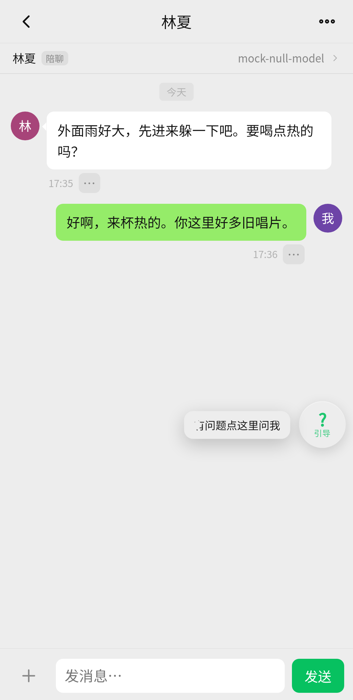 | 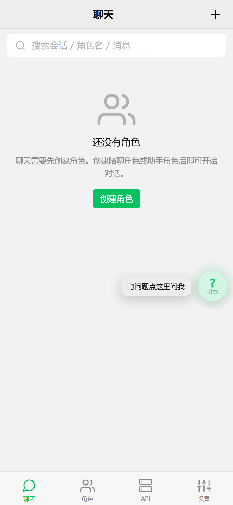 | 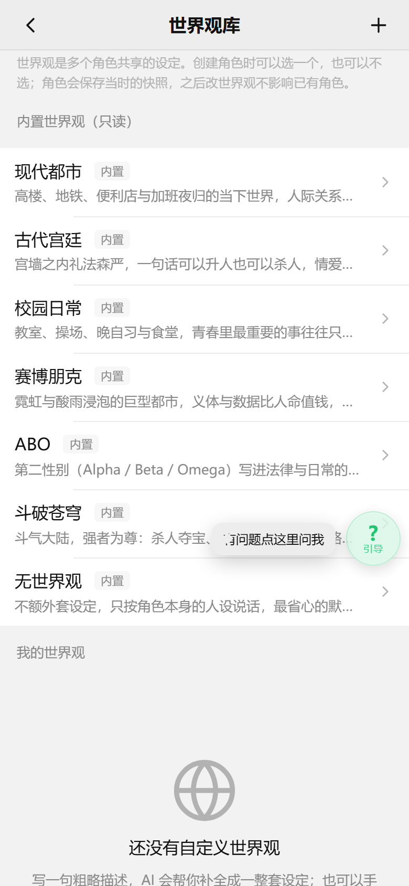 |

| 角色图片库 | 收发图片/文件 | 动作斜体 |
| --- | --- | --- |
| 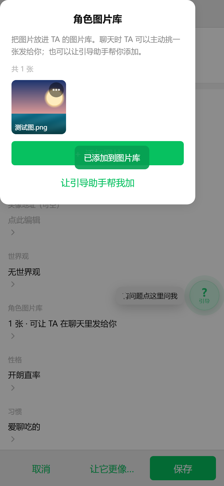 | 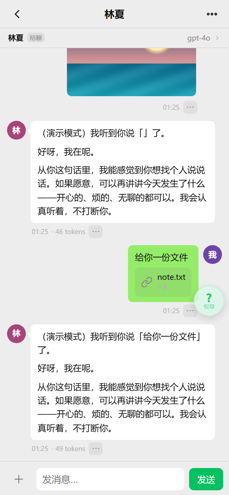 | 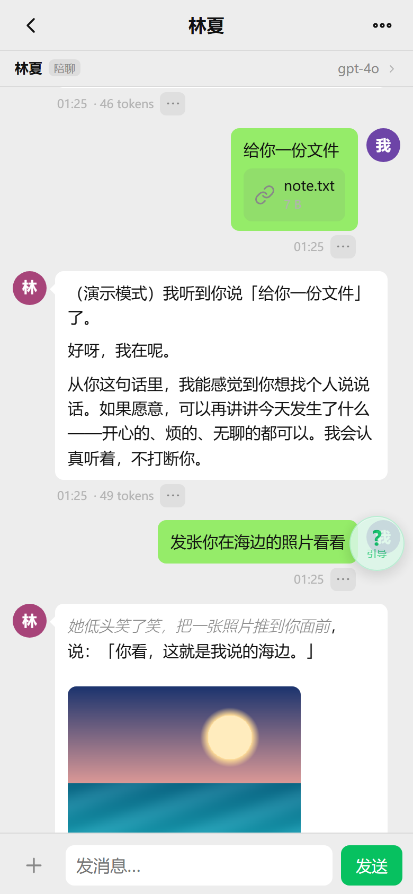 |

| 上帝模式 | 主动消息 | 主动消息设置 |
| --- | --- | --- |
| 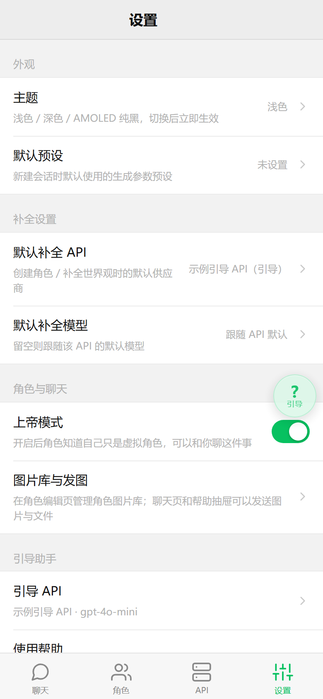 | 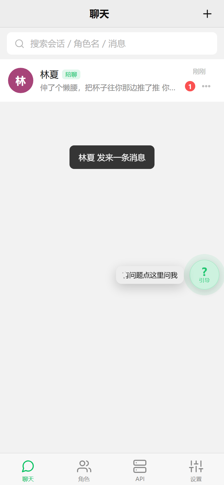 | 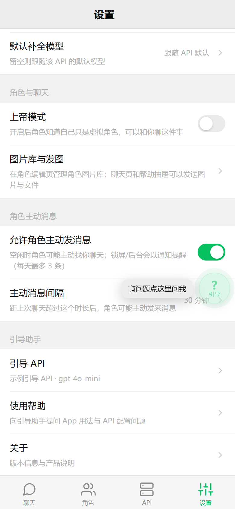 |

| 间隔上下限（v1.2.2） | 问候语备选 | 空开场白 |
| --- | --- | --- |
| 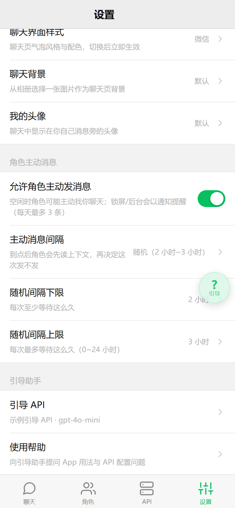 | 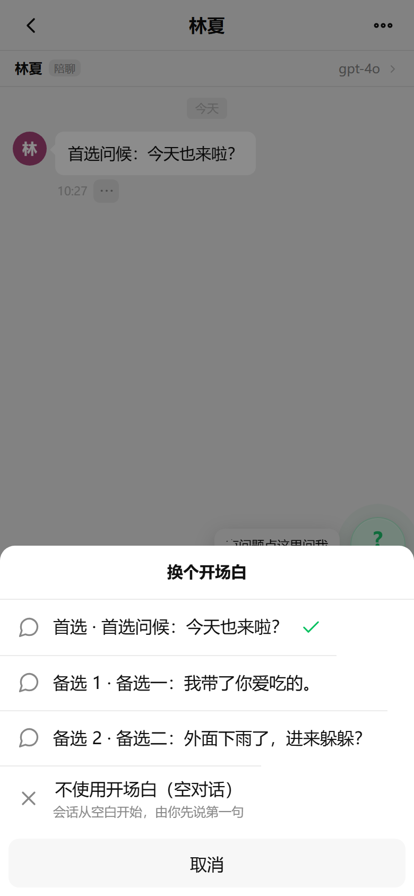 | 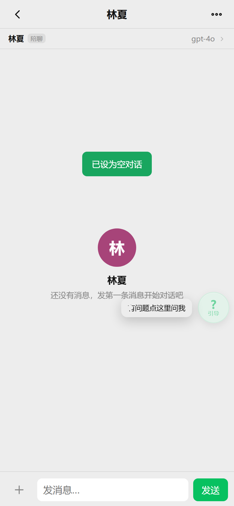 |

## 验证

- 无头 Chrome E2E：`scripts/audit.js`、`scripts/e2e-onboarding.js`(26)、`scripts/e2e-character.js`(28)、`scripts/e2e-chat.js`(16)、`scripts/e2e-guide.js`(14)、`scripts/e2e-acceptance.js`(32)、`scripts/e2e-media.js`(46)、`scripts/e2e-greetings.js`、`scripts/e2e-proactive.js` 全部通过。
- 「一串 null」修复单测（桌面 JVM + 真实 `org.json`，从 `Net.java` 原样提取方法）：`scripts/jvm-null/` **13/13 ALL PASS**。
- 设备端验证（Android 13 / API 33 模拟器，AEHD 加速）：`scripts/device-e2e.js` **17/17**、`scripts/device-null.js` **3/3**、`scripts/device-media-smoke.js` **7/7**；v1.2.x 另有 `scripts/device-proactive.js`。触摸实测：Tab 切换 103–360ms、流式中点「停止」357ms 响应。

## 构建

```powershell
pwsh -NoProfile -ExecutionPolicy Bypass -File scripts\build.ps1 -Clean        # 发布包
pwsh -NoProfile -ExecutionPolicy Bypass -File scripts\build.ps1 -DebugMode    # 调试包（WebView 可调试）
```

需要 JDK 17 与 `tools/android-sdk`（build-tools 34.0.0 + android-34；可用 `scripts/setup-sdk.ps1` 安装）。版本号在 `scripts/build.ps1` 顶部的 `$VersionCode` / `$VersionName` 与 `android/AndroidManifest.xml` 中维护，产物输出到 `build/AI-Chat-<版本>.apk`。

## 目录

```
android/            原生壳（Java）+ 前端资源 assets/www（13 个页面 + 核心模块）
scripts/            构建、SDK 安装、预览服务器、E2E/设备验证、截图脚本
docs/CONTRACT.md    前端模块契约
docs/DELIVERY.md    交付说明（指纹、验收对照、验证结果、已知限制）
docs/FEATURE-*.md   功能设计（图片库/上帝模式、主动消息/问候语）
docs/screenshots/   截图
releases/v<版本>/   各版本 APK（与 Releases 附件同文件）
```

详细交付说明见 [`docs/DELIVERY.md`](docs/DELIVERY.md)。
